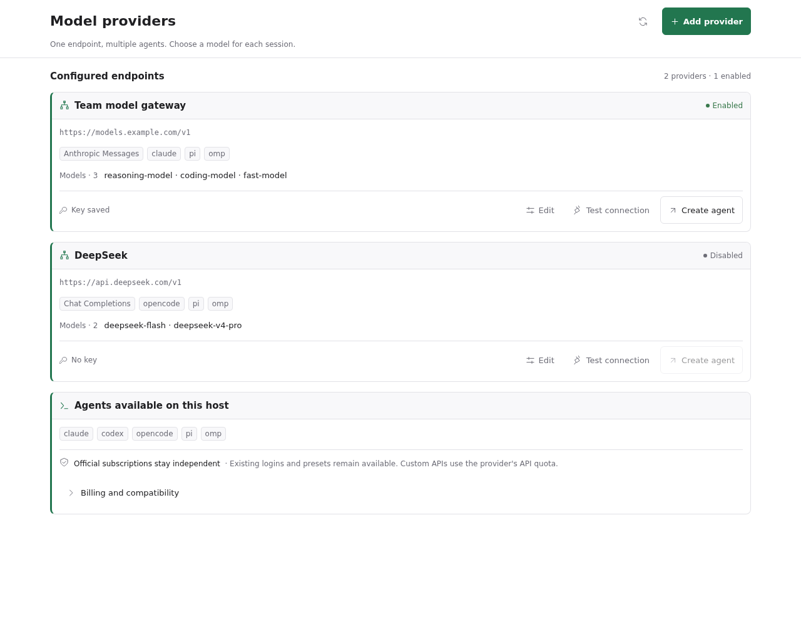
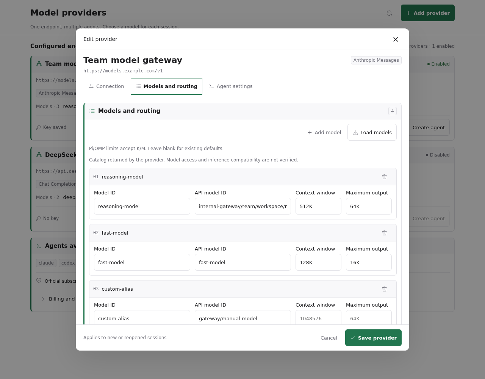

# Paseo model providers

[简体中文](README.zh-CN.md)

Manage API endpoints and models for multiple coding agents from one Paseo screen. Keep existing subscription logins available and use custom API providers for separate sessions.



## Supported protocols

| API protocol | Agents |
| --- | --- |
| Anthropic Messages | Claude Code, OpenCode, Pi, OMP |
| OpenAI Responses | Codex, Pi, OMP |
| OpenAI Chat Completions | OpenCode, Pi, OMP |

Protocols are not converted. For example, Codex requires an endpoint implementing Responses. Anthropic authentication supports x-api-key or Bearer tokens.

## Setup

Requires Paseo **0.12.0+** on the daemon and clients, with the agent CLIs already installed and visible to the daemon. Enable plugins on the intended host, then install the community-reviewed version:

```bash
paseo plugin add hulkzzhou1/model-providers
```

Open **Model providers** in the sidebar. The screen and sidebar label follow the device language, using Simplified Chinese when supported and English otherwise. Paseo 0.12.0 does not expose the app's manual language preference to plugins.

1. Select **Add provider** and choose **Custom** or the **DeepSeek** preset. Presets fill in defaults; the name, protocol, API base URL, models and limits remain editable. You can use a compatible proxy or gateway URL. Enter your API key after selecting a preset.
2. Select **Load models** to fill the model form automatically from the standard model endpoint. Use **Add model** for manual entries and remove rows you do not want to enable. Each row has a model ID and an optional API model ID; no comma-separated or multiline input is needed.
3. Edit the **API model ID** in a model row to map an alias, such as `deepseek-flash` → `gateway/deepseek`. Pickers display the model ID; connection tests and agents use the API model ID. Leave the API ID blank to use the model ID itself. Model IDs and API model IDs must each be unique within a provider.
4. Set context and output limits **in each model row**, then select compatible agents and save. Pi/OMP uses each model’s own limits, including mapped models. Full token counts and K/M shorthand are supported (`1K = 1000` tokens). Loading fills missing limits from catalog metadata and preserves manually entered values. Blank fields inherit the provider’s existing defaults, so old records retain their limits without migration.
5. Run **Test connection**, then **Create agent** with an absolute working directory on the daemon. Generated provider entries also appear in Paseo's normal agent picker.

The DeepSeek preset uses Chat Completions with `deepseek-flash` and `deepseek-v4-pro`. Defaults were checked against the [official model metadata](https://api-docs.deepseek.com/api/list-models/) on 2026-10-22; fetch the catalog to check current availability. A custom gateway can have different limits.



The editor shows a provider summary above tabs for connection, model routing and agent settings. Switching tabs preserves drafts, and validation returns to the relevant tab. Save and cancel stay visible while the active tab scrolls. Loading models merges new rows into the form without replacing manual IDs or mappings; repeated or failed loads preserve drafts. Each provider supports up to 100 model rows; excess catalog entries are reported.

Changes apply to new or reopened sessions. Existing sessions do not switch endpoints live. Custom APIs use the selected provider's API quota, independently of official subscriptions.

After updating the plugin, save existing Claude/Codex providers again to regenerate their launch configuration. Codex preserves an API base URL ending in `/v2` or another supported version path.

## Model discovery

Select **Load models** to query the API base URL's standard `/v1/models` endpoint. A base URL ending in a version path such as `/v1` or `/v2` keeps that version, so `/v2` queries `/v2/models`. Enter the API **base** URL, not a full `/chat/completions`, `/responses` or `/messages` endpoint.

The model endpoint must return a standard `{data:[...]}` response. Names and optional context/output limits are retained; Anthropic pagination is supported. Loading fills blank capacity fields by the actual API model ID and preserves manual values. When no compatible list is available, enter model IDs manually. Existing supplier records retain their defaults.

Requests send the provider key to the configured API endpoint and reject redirects. Errors do not echo response bodies or credentials. Discovery success does not prove model access or inference compatibility. Connection probes use non-streaming JSON and may fail on streaming-only services.

## Credentials and data

Keys are plaintext in the daemon's `PASEO_HOME/model-providers/suppliers.json` (directory 700, file 600) and generated Paseo provider environment configuration. Saved keys never return to the screen; a blank key during editing preserves the saved value. Official authentication files are not read or rewritten.

Catalog requests and tests contact the endpoint you configure. Tests send a short prompt and tool definition and can incur API charges. Started agents send prompts, code context and tool results to that provider according to the CLI's behavior. There is no plugin telemetry service. Read [the full data and compatibility notes](OVERVIEW.md) before connecting a provider.

## Validation and limitations

The automated suite covers adapter configuration for all five agents, standard model discovery, ignored retired settings, catalog pagination and failures, versioned protocol paths, key redaction, concurrent edit detection, rollback, alias collisions, file permissions, generated extensions, translations, editable presets, per-model catalog capacities, legacy default preservation and model ID mappings. Desktop/mobile layout checks use synthetic data and a preview harness; they are not native-device certification.

Real supplier streaming and complete agent tool/MCP workflows have not been verified across all five engines. Connection tests check basic response structure, not a full agent workflow. Pi/OMP custom models currently use text input, no extra reasoning and unknown pricing. The wide desktop editor has a documented compatibility workaround for Paseo 0.12's dialog structure.

## Development

```bash
npm ci --include=dev --ignore-scripts
npm run typecheck
npm test
paseo plugin install /absolute/path/to/paseo-model-providers
# After editing an installed checkout:
paseo plugin reload model-providers
```

Paseo provides runtime libraries; there are no runtime downloads or build commands. Generated credentials and configuration live outside this repository. The license is [MIT](LICENSE).

With Paseo and Codex installed, run the optional transport regression check against the installed Paseo adapter:

```bash
PASEO_CODEX_ADAPTER=/absolute/path/to/@getpaseo/server/dist/server/server/agent/providers/codex-app-server-agent.js npm run test:codex
```

It launches ephemeral Codex threads using a fake key and a local HTTP server to assert the actual request path. It does not call a model supplier or execute tools.
