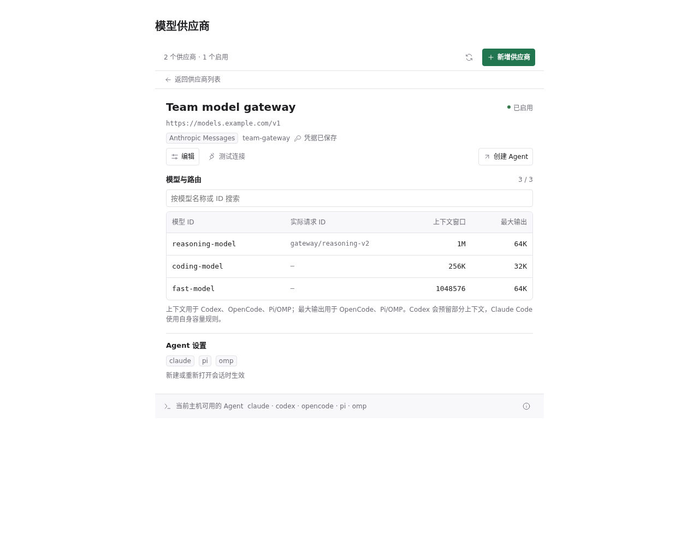
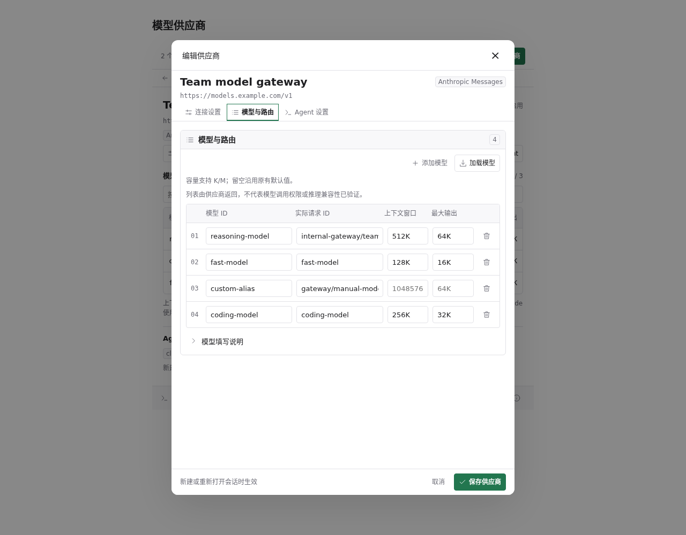

# Paseo 模型供应商

[English](README.md)

在一个 Paseo 页面中管理多种 Agent 的模型接口与模型列表，保留现有官方订阅登录，为独立会话选择自定义 API。



## 支持范围

| API 协议 | Agent |
| --- | --- |
| Anthropic Messages | Claude Code、OpenCode、Pi、OMP |
| OpenAI Responses | Codex、Pi、OMP |
| OpenAI Chat Completions | OpenCode、Pi、OMP |

不做协议转换。例如 Codex 需要供应商实现 Responses 接口。Anthropic 可选择 x-api-key 或 Bearer Token 鉴权。

## 安装与使用

Paseo daemon 和客户端均需 **0.12.0+**，所选 Agent CLI 需预先安装并对 daemon 可见。在目标宿主启用插件后执行：

```bash
paseo plugin add hulkzzhou1/model-providers
```

页面采用紧凑工作台布局：可按供应商名称、地址、模型别名、实际请求 ID 或 Agent 搜索，并按启用状态筛选。设置栏内通过返回按钮在列表和详情间切换，内容区域足够宽时左右并列展示列表和详情；详情中可直接查看模型映射及每模型容量。

从 **设置 → 插件 → 模型供应商** 打开；命令中心快捷入口也会打开同一设置页。主页侧边栏不再展示入口。页面和设置入口标题自动跟随设备语言，支持简体中文，其他语言回退为英文。Paseo 0.12.0 尚未向插件开放应用内手动设置的语言。

1. 点击「新增供应商」，选择「自定义」或「DeepSeek」预设。预设仅填入默认值，名称、协议、API 基础地址、模型和容量均可修改，可换成兼容协议的代理或网关地址。选择预设后再填写 API 密钥。
2. 点击「加载模型」，从标准模型接口自动填入模型表单。也可点击「添加模型」逐行填写，移除不需要启用的行。每行包含模型 ID 和可选的实际请求 ID，不再使用多行文本或逗号分隔输入。
3. 在模型行内修改「实际请求 ID」即可建立映射，例如 `deepseek-flash` → `gateway/deepseek`。选择器显示模型 ID，连接测试和 Agent 使用实际请求 ID；实际请求 ID 留空则使用模型 ID 本身。同一供应商内，模型 ID 和实际请求 ID 均不能重复。
4. 在**每个模型行内**分别填写上下文与最大输出，再选择兼容的 Agent 保存。Codex 通过原生模型目录接收各模型的上下文容量；OpenCode 和 Pi/OMP 接收上下文与输出容量，映射模型同样生效。支持完整数字或 `256K`、`1M` 等简写（`1K = 1000` Token）。加载目录会补齐未手动填写的容量，保留已填写值；空白字段沿用供应商原有默认值，旧记录无需迁移。
5. 执行「测试连接」，再通过「创建 Agent」填写服务器绝对工作目录启动。也可在 Paseo 原生创建入口选择生成的供应商。

DeepSeek 预设默认使用 Chat Completions 协议，包含 `deepseek-flash`、`deepseek-v4-pro`。默认规格于 2026-10-22 按[官方模型元数据](https://api-docs.deepseek.com/api/list-models/)核对，最新可用模型以获取结果为准；自定义网关的容量可能不同。



编辑器顶部显示供应商摘要，连接设置、模型与路由、Agent 设置采用页签分组；桌面模型采用紧凑表格，手机保留带标签的分组字段。关闭有修改的表单时需确认放弃，加载或保存过程中禁止继续编辑和关闭。切换保留草稿，表单校验失败返回对应页签。当前页签滚动时，保存与取消始终可见。加载模型会合并新增行，不覆盖手工 ID 或映射；重复加载或请求失败会保留草稿。每个供应商最多支持 100 行模型，超出时明确提示。

Codex 需要支持 `codex debug models --bundled` 的 CLI（已验证 0.160.1）。保存时沿用本机 CLI 的模型指令和工具配置，生成包含每模型上下文容量的本地目录。Codex 保留原生预留比例，例如 1,000,000 Token 当前上报 950,000 可用 Token。最大输出字段不配置 Codex 或 Claude Code；Claude Code 的上下文也使用自身规则。升级插件后，已有供应商需重新保存并重新打开会话。

配置在新建或重新打开会话时生效，进行中的会话不会热切换。自定义 API 使用对应供应商额度，与官方订阅独立计费。

## 模型自动加载

点击「加载模型」查询 API 基础地址下的标准 `/v1/models` 接口。基础地址以 `/v1`、`/v2` 等版本路径结尾时保留该版本，例如 `/v2` 查询 `/v2/models`。API 基础地址请勿包含 `/chat/completions`、`/responses` 或 `/messages` 等完整请求路径。

模型接口需返回标准 `{data:[...]}` 结构，保留模型名称和可选的上下文、最大输出容量；Anthropic 支持分页。容量按实际请求 ID 补齐空白字段并保留手工值。接口不提供兼容列表时，可手动填写模型 ID。旧供应商记录沿用原有默认容量。

查询会向配置的 API 接口发送供应商密钥，并拒绝重定向；错误不回显响应正文或凭据。发现模型不代表拥有调用权限或已兼容真实推理。连接测试采用非流式 JSON，可能不适用于仅支持流式请求的服务。

## 凭据与数据

密钥以明文存储在 daemon 的 `PASEO_HOME/model-providers/suppliers.json`（目录权限 700、文件权限 600）及生成的 Paseo Provider 环境配置中。页面不会回显密钥，编辑时留空沿用原密钥。插件不读取或改写官方认证文件。

模型查询和连接测试会访问你配置的接口。测试会发送简短提示词与工具定义，可能产生 API 费用。启动 Agent 后，提示词、代码上下文和工具结果会按 CLI 行为发送到该供应商。插件无遥测服务。完整说明见[数据与兼容性说明](OVERVIEW.zh-CN.md)。

## 验证与限制

更新插件后，已有 Claude/Codex 供应商需再次保存以重新生成启动配置。Codex 会保留 `/v2` 等受支持的版本路径。

自动化测试覆盖五种 Agent 的配置适配、标准模型查询、旧适配字段忽略、模型分页与异常、版本化协议路径、凭据隐藏、并发修改检测、失败回滚、配置冲突、文件权限、扩展生成、每模型容量、旧容量默认值保留及翻译。桌面和手机布局使用示例数据及预览环境验证，不代表原生设备认证。

尚未针对所有 Agent 完成真实供应商的流式响应、工具执行及 MCP 全流程验证。连接测试仅检查基础响应结构。Pi/OMP 当前按文本输入、无额外推理、费用未知注册模型。编辑器使用宿主弹窗，不再修改宿主的网页节点结构。

## 本地开发

```bash
npm ci --include=dev --ignore-scripts
npm run typecheck
npm test
paseo plugin install /absolute/path/to/paseo-model-providers
# 修改已安装的项目后：
paseo plugin reload model-providers
```

运行依赖由 Paseo 提供，无运行时下载或构建步骤。凭据与生成配置存储在仓库外。采用 [MIT 许可证](LICENSE)。

安装 Paseo 和 Codex 后，可针对已安装的 Paseo 适配器运行可选的请求回归检查：

```bash
PASEO_CODEX_ADAPTER=/absolute/path/to/@getpaseo/server/dist/server/server/agent/providers/codex-app-server-agent.js npm run test:codex
```

检查使用占位密钥和本地 HTTP 服务器，启动临时 Codex 会话并断言实际请求路径；不调用模型供应商，也不执行工具。
